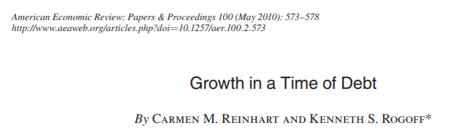
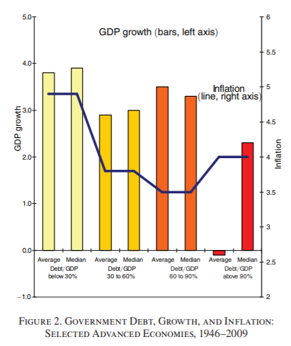
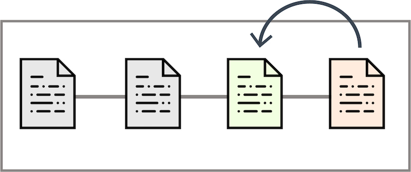
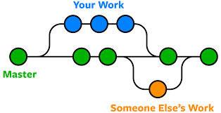
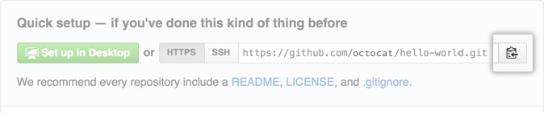
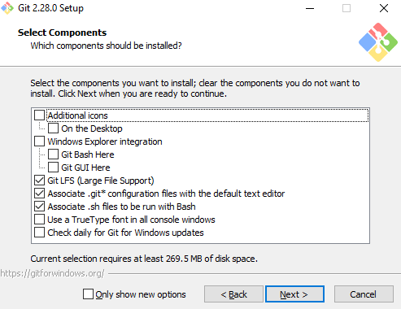
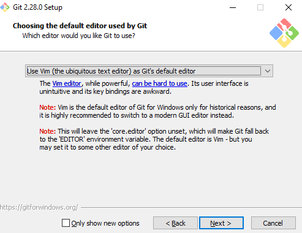
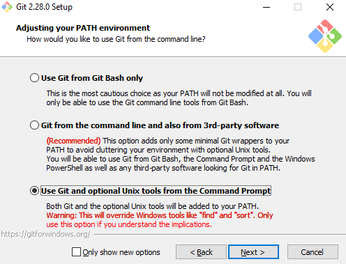

# Why is reproducible science important?

.pull-left[

- Paper by **Harvard economists Reinhart and Rogoff** (2010)

- Studied **20 advanced economies** over **1946–2009**

- Their headline claim:
  
  > When public debt exceeds 90% of GDP, average economic growth is approximately 0%.

- Used as an argument for austerity plans

- Can this result be reproduced?


]

.pull-right[
```{r, echo=F}

```

```{r, echo=F, out.width="90%"}

```
]

---

# Reproducing the result


.pull-left[

- In 2013, Thomas Herndon, a **PhD student** at the University of Massachusetts Amherst, tried to reproduce the result for an econometrics assignment.

- Working with economist Michael Ash, he requested the original spreadsheet from Reinhart and Rogoff.

- Checking the spreadsheet revealed:

  - a coding error,
  - omitted observations, and
  - an unconventional weighting method.

- The corrected average growth rate above 90% debt was **2.2%**, not approximately **0%**.
<br><br><br>
.center[
REPRODUCTION FOUND THE PROBLEM!

THE ANALYSIS COULD BE CHECKED!
]
] 


.pull-right[
```{r, echo=F}

```

```{r, echo=F, out.width="90%"}

```
]

---

# What this example teaches us
<br><br>

- **Published results can contain errors.**

- **Reproducibility makes those errors discoverable.**

- Sharing data, code, and analysis decisions makes results verifiable.

- A record of changes helps researchers understand, correct, and build on previous work.

???

The means had been computed in an unusual way.

Some available observations were omitted.

Most importantly, there was a coding error in the spreadsheet.

After correction, the average was 2.2% rather than approximately 0%.


--

<br><br>
.center[
**Git and GitHub help us preserve and share this history.**
]

---

# Version control: what is (G)it?

**Version control:**

.center[
*Program responsible for managing changes to computer programs, documents, large 
websites or other collection of information*
]

--

- Git was created by Linus Torvalds in 2005 to help develop the Linux kernel

- Git records snapshots of your files, so you can inspect or restore earlier versions

- A snapshot is called a **commit**

- Each commit has a unique identifier (hash) and usually a message

--

.pull-left[
<br><br>
**Allows you to come back to a specific commit**
]

.pull-right[
```{r, echo=F}



```

]

---
class: inverse, center, middle

# Reproducibility needs collaboration

## GitHub helps us share and review our work

---

# Git and GitHub

- **Git** runs on your computer and records the history of your project

- **GitHub** is an online platform for hosting Git repositories

- GitHub lets you share your repository and collaborate with others

- It provides repository hosting, pull requests, issues, code review, and project websites (GitHub pages)

- Git and GitHub work together, but they are not the same tool

---
class: inverse, center, middle

# How to use Git?


---

# Initialize your repository

- **Repository** ("repo") = directory that is version-controlled by Git, with files and history of their changes

--

<br>
- If you are starting from an existing GitHub repository, clone it:

``` 

git clone <repository-url>

```

<br>
- If you are starting from an existing local folder, initialize it: `git init`

<br>
- Now, a hidden directory `.git` can be found at the root of your project


<br>
.center[
**Don't ever modify this directory directly,<br>this is where all your backups are!!!!!**
]
---

# Your first commit

- First of all, the most useful command:

``` 

git status

```

--

Will tell you the *branch* you are on, the *deleted*, *modified*, *created* files, if the local commits are pushed, which changes are **staged**...

--

- **Stage** the changes using:

``` 

git add name_file_1 name_file_2 ... name_file_n  # if you want to stage specific changes, or
git add .                                        # if you want to stage every changes

```
--

- **Commit** using:

```shell 

git commit                      # a text editor will open where you can write the commit message. Or,
git commit -m "Commit message"  # if you want to write directly the commit message

```


---

# Branches


**Branch** = parallel line of development that diverges from the main line ("main" branch). Branches are used to isolate changes and work on new features or fixes without affecting the main codebase.

.pull-left[
<br><br>
```{r, echo=F}



```
]

--

.pull-right[

- A new repository commonly starts on a branch called `main`

``` 
git branch 
  * main
```

- You can create new branches

```
git branch new_branch_name
```

- And switch between existing branches


``` 
git checkout name_branch
Switched to branch 'name_branch'
```

]

---


# Merge and conflicts

.pull-left[
<br><br><br><br><br>
```{r, echo=F}


```
]

.pull-right[

- **Merge** branches together

From the `main` branch, use:

```
git merge new_branch
```

This combines changes from both branches. If necessary, Git creates a merge commit.

- **Conflicts**: if a file is modified on two branches, Git can't decide which change to keep when merging, causing a **conflict**. 

To resolve conflicts, manually edit the conflicted file, stage it with `git add`, and run `git merge --continue`.

]


---

# Check your commits and changes

- List the commits using:

``` 

git log             # or
git log --oneline   # or
git reflog

```

You will see the commit **hash** (a unique identifier), the author, date/time, and commit message.

--

- `git reflog` shows where `HEAD` has recently pointed, which can help recover from mistakes.

--

- See the changes of a commit:

```
git show <SHA>
```

--

- See the changes that are not committed:

```
git diff
```

---

# Undoing changes and commits

.center[
**Choose the command according to what you want to undo**
]

--

- Discard unstaged changes in a file:

```
git restore <file>
```


- Unstage a file without discarding its changes:

```
git restore --staged <file>
```


- `git reset` moves the current branch to another commit. It rewrites local history:

```
git reset --hard <SHA>
```

`--hard` also replaces the working files and can discard uncommitted changes.

- Advanced recovery/editing workflow:

```
git reset --hard <earlier-SHA>
git reset --soft <later-SHA>
```

This restores the earlier files, then moves `HEAD` back while keeping the intervening changes staged.

---

# Useful tips


**Ignore files**

- You can specify the files/directories that you never want to commit in the `.gitignore` file


--
<br>

**git stash**

- Temporarily saves uncommitted modifications using `git stash`

- List the stashes using `git stash list`

- You can bring back a specific stash using `git stash apply stash@{n}`

---
class: inverse, center, middle

# Moving on to 

# GitHub

---

# Publish your local repository online

.pull-left[

- Create an empty repository on GitHub

<br>

- Copy the repository URL

]


.pull-right[
```{r, echo=F, out.width="30%"}
knitr::include_graphics(path = "images/repo-create.png")
```
<br>

]

--

- Now, `push` your existing repository from the command line:

```
git remote add origin https://github.com/user_name/repo_name.git
git branch -M main
git remote -v
git push -u origin main
```

--

.center[
**From now on, you can publish your local commits using** `git push`

**Use** `git fetch` **to download remote commits without changing your files.**

**Use** `git pull` **to fetch and integrate remote changes into your current branch.**
]

--

GitHub may ask you to authenticate using a browser login, personal access token, or SSH key.

---

# Optional: Large File Storage

- GitHub has a file size limit: 100 MB

- You can bypass this limit using **Git Large File Storage**

- You need to install the software ([here](https://git-lfs.com/))

- Specify the large files you want to track using `git lfs track images/*.png`

- This will create a file `.gitattributes`

- Next commit you'll do, the tracked large files will be handled in a specific way so you can push the commits online

---

# Clone a GitHub repository


.center[
**Nothing more simple**
]

--

<br><br>

- Go to a GitHub repository

<br><br>

- Copy its URL

<br><br>

- Clone it from the command line using:

```
git clone https://github.com/user_name/repo_name.git
```
---

# Forking a GitHub repository

- A fork is your GitHub copy of someone else's repository

<br><br>

- You can modify your fork without changing the original repository

<br><br>

- You can propose your changes to the original repository using a `pull request`

---

# GitHub Pages

- GitHub Pages publishes a website from a repository

<br>

- Go to *Settings > Options > GitHub Pages* and select the branch and folder containing the site files

<br>

- GitHub Pages normally uses `index.html` as the site's entry point

<br>

- If your HTML file has another name, use the URL provided by GitHub and append the filename

<br>

- You can also host a user site at `username.github.io`

---
class: inverse, center, middle

# Friendly user applications

### [<ins>GitHub Desktop</ins>](https://desktop.github.com/) 

### [<ins>Visual Studio Code</ins>](https://code.visualstudio.com/)

---
class: inverse, center, middle

# Thank you for your attention

## Now, install git from [<ins>here</ins>](https://git-scm.com/)

---

# Tips for git installation


* You can either spam `next` and then click `install`


.center[
**Or**
]

* Uncheck the `Additional icons` and `Windows Explorer integration` features (they are cumbersome)

.center[
```{r, echo=F, out.width="60%"}



```
]

---

# Tips for git installation


* Here you can choose the text editor used for commits, picking and squashing... By default, Git is set up to use Vim (and you need to know Vim commands to use it)

.center[
```{r, echo=F, out.width="60%"}



```
]

---

#  Tips for git installation

* Last but not least: here you can set up Git in order to also use shell commands (and not only commands specific to your OS). It also allows the (very very) cool `Julia`'s feature to use shell commands directly in the `Julia` REPL

.center[
```{r, echo=F, out.width="60%"}



```

]

---

# One last thing

<br>

* If you just installed Git on your computer, it may come useful to specify your name and email address to Git using:

```

git config --global user.name "Your name"

git config --global user.email "address@domain"

```

<br>

* Now, you should be able to see these changes using:

```

git config --global --list

```
